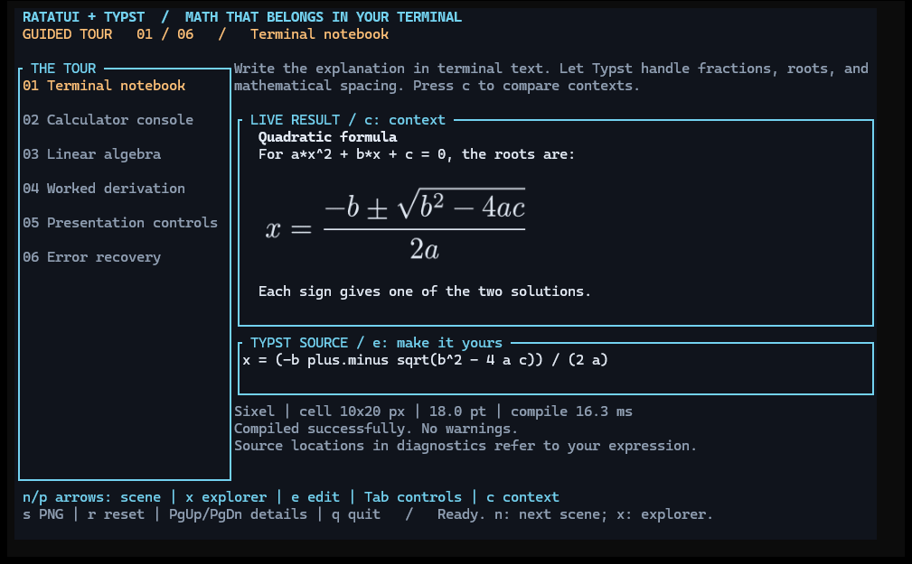
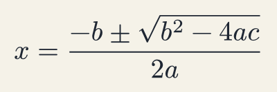
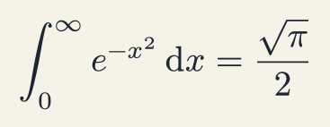
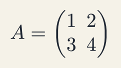
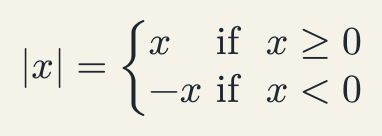

# ratatui-typst

An experimental companion crate for typeset block equations in Ratatui.
Typst is embedded in Rust; `ratatui-image` handles terminal graphics. No Typst
executable, LaTeX installation, or PNG round trip is needed to display math.

This is an **unpublished 0.1.0 candidate** with a provisional API. The project and
crate name is `ratatui-typst`; Rust imports use `ratatui_typst`.
Repository: [SosiNone/ratatui-typst](https://github.com/SosiNone/ratatui-typst).



The demo pairs typeset equations with ordinary terminal text. Take a six-scene
tour, then switch to the explorer to edit math and tune rendering.
See the [demo guide](demo/README.md) for screenshot details and controls.

## Run the demo

Requires **Rust 1.92+** and a terminal at least **76 columns by 24 rows**.
The first build compiles Typst and can take several minutes. No Typst CLI or
LaTeX installation is needed. From the repository root:

```sh
# Guided tour (or: task demo)
cargo run --locked -p ratatui-typst-demo

# Skip graphics detection and use the coarse character fallback
cargo run --locked -p ratatui-typst-demo -- --halfblocks

# Open the explorer with your own Typst math, without $ delimiters
cargo run --locked -p ratatui-typst-demo -- 'A = mat(1, 2; 3, 4)'

# Export an equation without opening the terminal UI
cargo run --locked -p ratatui-typst-demo -- --png output/equation.png
```

Use **n / p or arrows** to navigate scenes, **x** to switch tour / explorer,
**e** to edit, **Tab** for rendering controls, and **c** to compare Note / Console /
Plain contexts. **s** saves a PNG; **q** quits. Enter compiles an edit; Esc cancels it.

Graphics detection runs once at startup. **Ghostty 1.3.1 on Linux is validated
with Kitty graphics**, including resizing, transparency, replacement, and exit
cleanup. The demo falls back to half-block characters if detection fails.
Windows Terminal has a positive SIXEL rendering report; its full lifecycle
validation remains pending. PowerShell is a shell, so graphics support depends
on its terminal host. Other terminals and multiplexers remain unverified.
See the [terminal validation procedure](docs/TERMINAL_TESTS.md) for current evidence.

## Rendered examples

These PNGs come directly from the embedded renderer, using an opaque Paper
palette so they stay readable in light and dark README themes. They demonstrate
typesetting output; they are separate from the terminal screenshot above.

| Quadratic formula | Gaussian integral |
| --- | --- |
|  |  |
| `x = (-b plus.minus sqrt(b^2 - 4 a c)) / (2 a)` | `integral_0^infinity e^(-x^2) dif x = sqrt(pi) / 2` |

| Matrix | Piecewise function |
| --- | --- |
|  |  |
| `A = mat(1, 2; 3, 4)` | `abs(x) = cases(x &"if " x >= 0, -x &"if " x < 0)` |

Regenerate all four images from the same built-in examples:

```sh
cargo run --locked -p ratatui-typst-demo -- --showcase-assets assets/demo
# Or: task showcase-assets
```

## Development

The root package is the library and default workspace member; the unpublished
demo shares its lockfile and is excluded from the library archive. Embedded
typesetting adds substantial build and binary size. Fonts are bundled through
`typst-assets`; installed fonts and the working directory do not affect discovery.

Run the checks with [Task](https://taskfile.dev/), or use Cargo directly:

```sh
task check
cargo test --workspace --locked
cargo doc --locked -p ratatui-typst --no-deps
```

See [CONTRIBUTING.md](CONTRIBUTING.md), [architecture](docs/ARCHITECTURE.md), and
the [release checklist](docs/RELEASE.md). For the smaller public API example:

```sh
cargo run --locked --example terminal                 # Detect terminal graphics
cargo run --locked --example terminal -- --halfblocks  # Coarse fallback
cargo run --locked --example terminal -- --smoke       # Headless consumer check
```

The example uses only public APIs and exercises replacement, errors, movement,
overlays, hiding, shrinking, and transparency. See the [terminal test procedure](docs/TERMINAL_TESTS.md)
and [API review](docs/API_REVIEW.md).

## Library use

[src/lib.rs](src/lib.rs) is the public library entry point. Supply Typst math
without `$` delimiters. Until publication, use a local path dependency from
an application in a sibling directory:

```toml
[dependencies]
ratatui-typst = { path = "../ratatui-typst" }
ratatui = "0.30.2"
ratatui-image = { version = "11.1", default-features = false, features = ["crossterm"] }
```

```rust,no_run
use ratatui::layout::Size;
use ratatui_image::picker::Picker;
use ratatui_typst::{Equation, MathRenderer, RenderOptions};

fn main() -> Result<(), Box<dyn std::error::Error>> {
    let renderer = MathRenderer::new();
    let equation = renderer.render("x = sqrt(2)", &RenderOptions::default())?;
    // Query once after terminal initialization, before reading events.
    let picker = Picker::from_query_stdio()?;
    let prepared = equation.prepare(&picker, Size::new(40, 10))?;
    // Inside terminal.draw: frame.render_widget(Equation::new(&prepared), area);
    Ok(())
}
```

`MathRenderer` reuses the standard library and shared bundled fonts. Rendering
returns pixels, natural size in points, the original source, and warnings.
Compilation errors include expression-relative byte ranges and line/column
locations where available. `RenderOptions` controls size, padding, resolution,
and foreground/background colors. Backgrounds are opaque by default. Set
`transparent_background: true` to omit the page fill while retaining
`background` as the matte color for SIXEL edges and half-block previews.
`required_cells` calculates natural
cell dimensions from the terminal's cell size in pixels.

`prepare` proportionally shrinks an image if needed and encodes it for the
application's shared `Picker`. Keep the result between draws and reprepare when
the panel or cell dimensions change. Zero-sized panels produce an empty widget.
`PreparedEquation::size()` reports the fitted dimensions in terminal cells for
placement and centering; zero-sized preparations report `0 x 0`.
The `Equation` draw path only displays the prepared image. Both rendering and
preparation are synchronous and can still delay input handling outside
`terminal.draw`. Applications can schedule them on their
own workers. A worker example and a bounded result cache are future work.

Transparent images retain full alpha with Kitty. Preparation first fits the
image onto a transparent canvas rounded to whole cells. SIXEL then blends
antialiased edge pixels against the configured background and keeps fully
transparent pixels undrawn; half-blocks receive an opaque composite. Match
`background` to the widget's panel color, including when using transparency.
PNG output from `image()` retains its original alpha.

## Current limits and release work

- Block math only; no inline paragraph layout, evaluation, or plotting engine.
- Rasterized text is not selectable or accessible as native terminal text;
  keep the source available to users.
- File/package resolution and the current date are unavailable. This does not
  bound Typst evaluation time or memory for hostile input.
- Raster output is capped at 16 megapixels and 16384 pixels per side. This
  check occurs after typesetting, so it is not a compiler resource limit.
  The same bounds apply to the whole-cell canvas allocated during preparation.
- Uses Typst's full bundled font set initially; custom fonts and a smaller
  default bundle are pending.
- Typst's process-wide memoization cache is aged after each compilation; there
  is no byte-bounded equation cache or asynchronous stale-result handling yet.
- Real graphics validation covers Ghostty 1.3.1 on Linux. The Windows Terminal
  lifecycle report is pending completion. Buffer tests cannot establish real
  graphics behavior or compatibility with other terminals and multiplexers.

Project code is licensed under [MIT](LICENSE), copyright 2026 ratatui-typst
contributors. Bundled dependencies and fonts retain their own licenses;
see the [license review](licenses/REVIEW.md) and [font notices](licenses/README.md).
`publish = false` remains set until the remaining
[release checks](docs/RELEASE.md) pass. No version has been published to crates.io.

References: [Typst math](https://typst.app/docs/reference/math/),
[Typst World interface](https://docs.rs/typst/0.15.1/typst/trait.World.html),
[ratatui-image](https://github.com/ratatui/ratatui-image).
