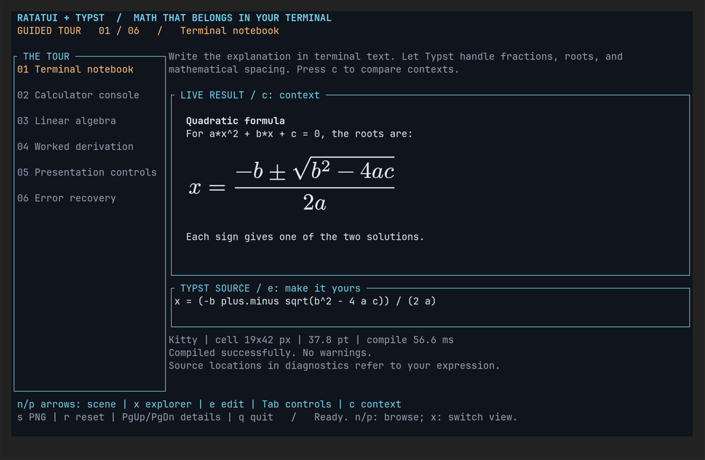
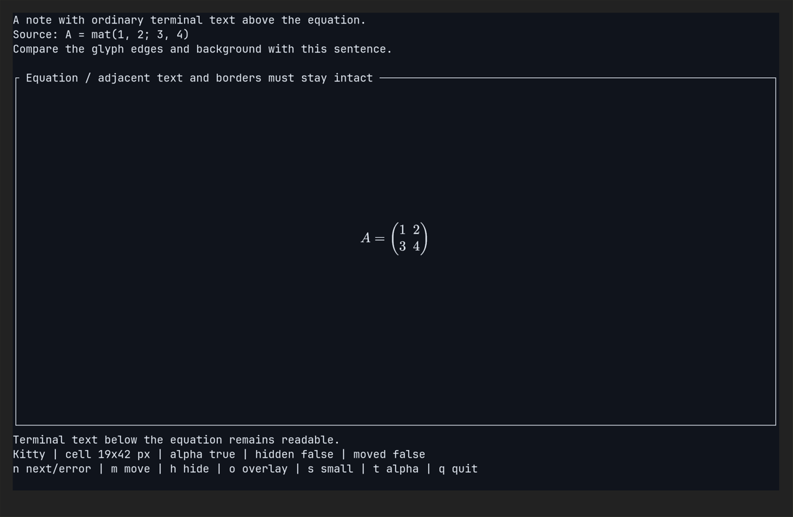
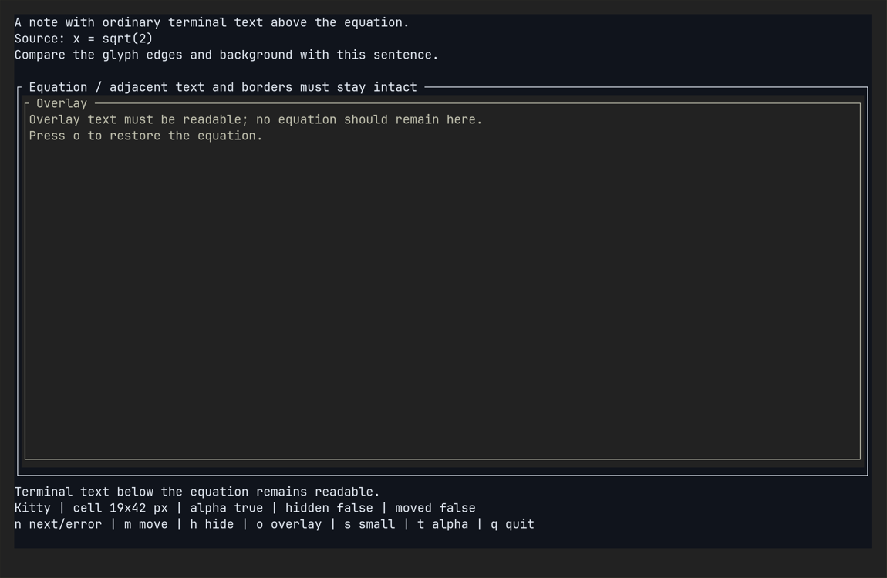
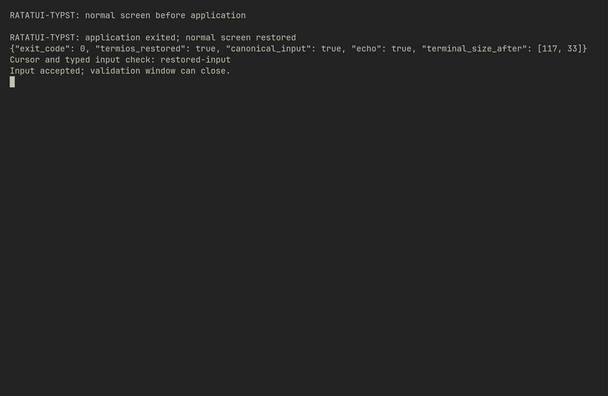

# Terminal Lifecycle Validation

Run from the library repository root:

```sh
cargo run --locked --example terminal
```

Ghostty 1.3.1 on Linux has passed the Kitty procedure below. Full Windows
Terminal/SIXEL lifecycle validation is optional follow-up, not a 0.1.0 release
gate, per the maintainer's decision on 2026-10-16. Its lifecycle coverage and exit
cleanup remain unverified.
The example displays the selected backend and cell dimensions. If detection
chooses Halfblocks, record a fallback result; do not count it as a graphics pass.
The terminal's shell is not evidence of graphics support.

## Procedure

Check that adjacent terminal text and borders remain readable after every step.
Record failures with screenshots and the exact key sequence.

| Step | Action | Expected result |
| --- | --- | --- |
| 1 | Start normally | Centered equation; correct colors and no stray graphics |
| 2 | Resize the terminal smaller, then larger | Proportional fitting and correct placement; no old image remains |
| 3 | Press `s` twice | Fit into a tiny viewport, then restore full space |
| 4 | Press `n` | Replace root expression with a matrix; old pixels disappear |
| 5 | Press `n` | Compiler error replaces the image with source-relative diagnostics |
| 6 | Press `n` | Recover the original equation |
| 7 | Press `m` twice | Move the widget and restore it without ghost images |
| 8 | Press `o` twice | Remove image, show readable overlay, restore image |
| 9 | Press `h` twice | Remove and restore image without residue |
| 10 | Press `t`; repeat steps 2–9 | Transparent edges and padding blend correctly |
| 11 | Press `q` | Restore normal screen and cursor; no graphics remain |
| 12 | Relaunch; press Ctrl+C | Clean exit through the application's handler |

Repeat with `--halfblocks` as a separate fallback check. Test multiplexers
separately if you intend to claim support for them.

## Report template

- Date and Git commit:
- OS and Rust version:
- Terminal name/version and shell:
- Multiplexer (or none):
- Detected backend and cell dimensions:
- Opaque steps 1–12: PASS / FAIL / NOT RUN, with notes:
- Transparent steps 2–9: PASS / FAIL / NOT RUN, with notes:
- Exit and graphics cleanup:
- Screenshots and reproduction steps:

## Current evidence (2026-10-16)

- Automated half-block consumer: passed against Ratatui's `TestBackend`.
- Interactive PTY: half-block startup and keyboard lifecycle checks; results in
  [RELEASE.md](RELEASE.md). This is not Kitty/SIXEL validation.
- The maintainer reports that rendering looks good on Windows with PowerShell.
  The displayed backend was confirmed as **Sixel**. This is a positive manual
  SIXEL rendering result. Windows Terminal 1.24.12741.0 is installed; the tested
  terminal version, cell dimensions, and individual procedure results have not
  yet been recorded. Lifecycle coverage and exit cleanup remain unconfirmed.
- Real Kitty procedure: **passed on Linux/Ghostty 1.3.1**, including transparent
  rendering and normal/Ctrl+C exit cleanup. See the report below.
- Windows/Linux stable and Linux Rust 1.92 passed the
  [initial workspace CI run](https://github.com/SosiNone/ratatui-typst/actions/runs/38145063622).
  These are headless results, not additional real-terminal graphics evidence.

## Linux / Ghostty report (2026-10-16)

Validated source revision: `48ac95b89f474f10f40b628bb9c471583be5bc8e`.
The source was unchanged during validation; this report and its captures were
added afterward. No library, dependency, or public API changes were required.

| Environment | Value |
| --- | --- |
| OS | Omarchy 4.0.4 (Arch Linux family), x86_64 |
| Kernel | Linux 7.2.5-3-omarchy |
| Rust / Cargo | 1.98.1 |
| Terminal | Ghostty 1.3.1-arch2, GTK / OpenGL |
| Desktop | Hyprland 0.56.2, Wayland, display scale 2 |
| Graphics detection | Kitty, 19×42px cells |
| Forced fallback | Halfblocks, fixed 10×20px reference cells |
| Main terminal viewport | 117×33 cells |
| Multiplexer / SSH | None; local session |
| Launcher | Python wrapper running the binaries through util-linux `script`; no interactive shell |
| Font / capture settings | JetBrainsMono NF, 12pt; opaque test window; `NO_COLOR` unset |

The binaries were built from the repository root with locked dependencies:

```sh
cargo build --workspace --examples --locked
cargo build --locked -p ratatui-typst-demo
```

The consumer was run both normally and with `--halfblocks`. A temporary Python
harness launched dedicated Ghostty windows, used Hyprland to identify and resize
only those windows, and used `wtype` to supply keyboard input. `script` forwarded
real terminal capability responses and recorded terminal I/O; no responses were
simulated. `grim` captured each test window, and the captures were visually
inspected. Desktop focus was restored after each run.

| Procedure | Kitty | Forced half-blocks |
| --- | --- | --- |
| 1: startup, text, colors, and borders | PASS | PASS, coarse character rendering |
| 2: window shrink and restore | PASS | PASS |
| 3: tiny viewport and restore | PASS | PASS |
| 4–6: matrix replacement, error, and recovery | PASS | PASS |
| 7: move and restore | PASS | PASS |
| 8: overlay and restore | PASS | PASS |
| 9: hide and restore | PASS | PASS |
| 10: transparency; repeat 2–9 | PASS | PASS, opaque compositing as designed |
| 11: normal quit | PASS | PASS |
| 12: relaunch and keyboard Ctrl+C | PASS | PASS |

Consumer resize checks used 440×280 and 1150×750 logical pixels. Old images
disappeared after replacement, movement, hiding, errors, and overlays. Resizing
and restoring the viewport preserved fitting and placement. Text and borders
remained intact; in the deliberately small window, long text wrapped or clipped
within the available layout. Transparent glyph edges and padding matched the
panel without visible halos.

Normal quit and Ctrl+C each returned exit code 0 and restored the original
terminal attributes, including canonical input and echo. The wrapper's original
normal-screen marker reappeared without graphics residue; a visible cursor and
subsequent typed input confirmed the terminal remained usable.

The demo was also exercised in Ghostty: all six tour scenes, window shrink and
restore (850×580 and 1150×750 logical pixels), explorer switching, invalid source
and recovery through the editor, text size, padding, raster scale, all three
palettes, automatic/half-block switching, Note/Console/Plain contexts, reset,
normal quit, and Ctrl+C. Results: PASS. Captures were taken after terminal output
settled; input recordings were used to distinguish automation errors from
application behavior.

Representative real-window captures (captured at scale 1; not PNG exports from
the math renderer):

| Demo using Kitty | Transparent matrix using Kitty |
| --- | --- |
|  |  |

| Overlay removes the equation | Terminal after quit and accepted input |
| --- | --- |
|  |  |

Bulk captures, terminal recordings, exit reports, and the temporary automation
scripts are kept locally under ignored `output/linux-ghostty-2026-10-16/`.
This report establishes the tested Ghostty configuration only. The Kitty terminal
application, other Linux terminals, multiplexers, SSH, font zoom during execution,
and Linux SIXEL were not tested. Windows lifecycle validation remains unverified
and is optional follow-up.
